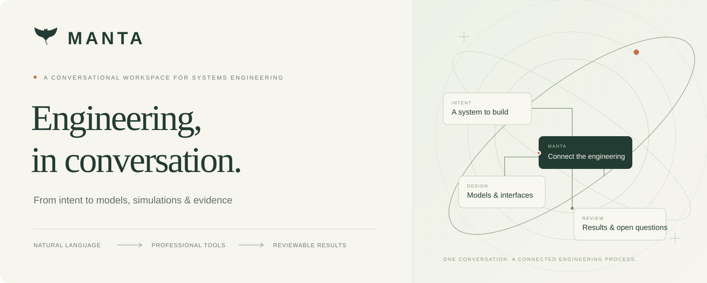
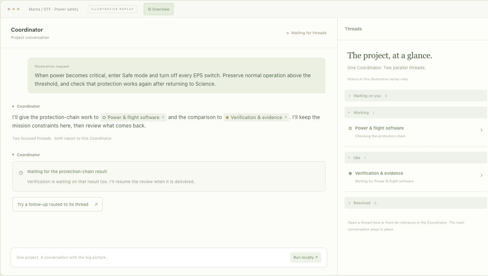
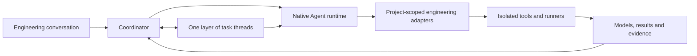

<p align="center">
  
</p>

<p align="center">
  <strong>A conversational workspace for model-based systems engineering.</strong><br>
  Describe the system. Explore the design. Follow the evidence.
</p>

<p align="center">
  <a href="https://mingxiye.github.io/Manta/">Website & interactive demo</a> ·
  <a href="#get-started">Get started</a> ·
  <a href="docs/demo.md">STF walkthrough</a> ·
  <a href="README.zh-CN.md">简体中文</a>
</p>

<p align="center">
  <a href="LICENSE"></a>
  
  
  
</p>

---

Manta brings the way you work with a coding Agent to systems engineering. Start with an engineering goal, an existing model, or a failing test. Work through the problem with a **Coordinator and one layer of task threads**, then open the models, documents, simulation results, and evidence from the conversation.

The ambition is simple: **make complex engineering approachable through language**. The engineering still needs real tools, traceable decisions, and valid evidence.

> [!NOTE]
> Manta is a research prototype. Selected tool integrations and engineering iterations have been exercised; complete STF mission development and acceptance remain unfinished. The website demo replays recorded results. It does not run a live Agent or solver.

## See it before you install it

**[Explore the interactive walkthrough →](https://mingxiye.github.io/Manta/#demo)**

GitHub Pages is the publishing target; the maintainer must enable it before this address becomes available. [Deployment setup](docs/github-pages.md).

[](https://mingxiye.github.io/Manta/#demo)

Follow a selected STF low-power engineering iteration. The Coordinator stays in the main conversation; open a peer thread in the right pane, try a labelled scripted follow-up, and inspect its reviewed handoff. Design relationships, the frozen test recipe, telemetry and evidence open from the conversation.

| Recorded native run | Observed result |
| --- | --- |
| Original configuration | **3 / 5** selected checks passed; failure retained |
| Corrected configuration | **5 / 5** selected checks passed; **473** EPS telemetry samples |
| Evidence | Original CSV files, model/input hashes, and check-level observations |

These runs cover selected **NOS3 / cFS / NASA 42 / EPS software integration**. They do not establish full STF mission behavior, science delivery, hardware qualification, or flight readiness. The walkthrough narrative is curated; numerical data and check outcomes come from retained native execution on 23 October 2026. See [the demo guide](docs/demo.md) and [recorded evidence](website/dist/assets/evidence/README.md).

## A conversation that does real work

**Keep the big picture.** The Coordinator maintains the goal, dependencies, decisions, and open questions. Task threads carry focused work; you can speak directly to any thread. The Coordinator waits for required results, reviews them, and brings the findings back.

**Use the tools when the work needs them.** Models, code, circuits, geometry, and numerical studies remain inspectable artifacts. Open supported documents and model source, review curves and tables, and keep failed checks alongside corrected results.

**Bring your own Agent and model.** Manta reuses **Codex app-server** and **Claude Agent SDK** for the native Agent loop, sessions, tools, and approvals. Model ID, endpoint, and API key are connection settings. Provider compatibility must be tested; a custom endpoint is not automatically compatible with every Agent feature.

**Continue an existing project.** Select a project folder and ask for the next increment: investigate a failure, change a requirement, compare a design, or prepare a review. The workflow supports iteration rather than requiring a one-way phase wizard.

## Engineering integrations

The source includes the following adapters and viewers. Availability is project-specific; installing the Node application alone does not provision all solvers or runners.

| Integration | Work supported in Manta | Scope |
| --- | --- | --- |
| **SysML v2 / KerML** | Source editing, semantic checks, queries, structural diagrams, outline and diagnostics | Pinned Open-MBEE kernel; no dynamic SysML behavior execution |
| **OpenModelica** | Model/parameter editing, native isolated jobs, numerical signals and CSV exports | Configured runner required |
| **ngspice** | Native circuit transient jobs and result curves | Configured runner required |
| **OpenSCAD** | Geometry generation and interactive STL inspection | Configured runner required |
| **NOS3 / cFS / NASA 42** | Selected native software-integration recipes, telemetry and checks | Selected workflows; not unrestricted full-mission validation |
| **GDAL / PROJ / NASA 42 orbit** | Geographic jobs, coordinate work, native orbit outputs and map previews | Isolated development preview; deployment varies |
| **External MCP** | Project-scoped stdio and Streamable HTTP connections | A gateway; each professional integration still needs its own setup and validation |
| **Documents & evidence** | Markdown, source, CSV/JSON plots and tables, bounded GeoJSON preview | Protected job evidence remains read-only |

Capella, Cameo, MATLAB/Simulink, FEM, RF, PCB, and hardware platforms should not be assumed to be integrated. A tool name or an MCP connection does not establish a validated engineering workflow.

## Get started

Requires **Node.js 22.13+** and npm. The product website is published independently through GitHub Pages.

```sh
git clone https://github.com/MingxiYe/Manta.git
cd Manta
npm ci
npm run doctor
npm start
```

Open **[localhost:4317](http://127.0.0.1:4317)**. Then:

1. In **Settings → Models & API**, configure and test Codex or Claude Code.
2. Create a project and select a separate engineering folder.
3. Describe the goal, constraints, and the existing materials you want Manta to use.
4. Follow the Coordinator, enter a thread when needed, and open artifacts from the chat.

No VM or Python package is needed to start the application. Codex requires a separately installed CLI; Claude uses the project-local Agent SDK. For macOS desktop, `npm run desktop` additionally requires Apple command-line build tools. The managed Linux VM workflow targets Apple Silicon macOS; a complete public installer for the exact frozen professional-tool bundle is not yet available. `npm ci` does not provision those solvers. See [installation and platform scope](docs/installation.md), [repository scope](REPOSITORY_SCOPE.md), and [native runtimes](docs/agent-runtime.md).

To customize startup, copy `.env.example` to this checkout’s `.env`. Manta loads it as data; existing process environment variables take precedence. Launch methods share the default `data/` directory, and `MBSE_DATA_DIR` can select another location. Keep `.env` and runtime data out of Git. Keys entered in the UI remain in process memory and must be re-entered after a service restart. Choose Manual or Auto permissions for your work; those modes retain the runtime and application approval boundaries. The service binds to loopback and has no multi-user authentication; run it locally rather than exposing it as a public backend.

### Start with an engineering request

```text
Develop a small satellite for an STF science mission. Collect science data
over the continental United States, Alaska, and Hawaii, and only near the
United States. Handle faults autonomously, support at least three months
of science collection, and deliver all collected science data to the ground
within 24 hours. Spacecraft health takes priority over collection.

Research authoritative public sources, identify missing decisions, develop
the engineering models, and execute available verification. Preserve
unverified requirements and explain what evidence is still needed.
```

This describes the **requirements-first target case**, not a promise that the full mission is already supported or accepted. Existing candidate design documents belong to the evaluator reference, not hidden input for a from-zero test. The recorded website walkthrough is a separate, narrower engineering increment.

## How Manta fits together



Manta owns project context, task coordination, permission bridges, artifact navigation, and evidence handoff. Codex and Claude supply their native Agent runtimes. Engineering execution happens through configured tools and runners. A task completing, a solver exiting successfully, a verification check passing, and a system being accepted are separate events.

## What we are working toward

**Complete STF first. Apollo next.** Manta aims to support real systems-engineering work from mission intent through design, implementation, integration, verification, validation, and subsequent changes.

Current recorded milestones include bounded model checks, numerical studies, and selected software integration. Open work includes complete mission coverage and data delivery, broader detailed design, hardware/HIL, environment and lifetime evidence, and independent review. Applicable requirements stay open until valid evidence or an authorized decision closes them.

The long-term experience is “describe a complex system and develop it through conversation.” Manta has not completed a Model 3, Apollo spacecraft, or a fully accepted STF mission.

## Develop & explore

```sh
npm run smoke
npm test
```

| Path | Contents |
| --- | --- |
| `server/` | Coordination, native runtime adapters, permissions and engineering services |
| `public/` | Conversation UI and artifact work surfaces |
| `shared/` | Shared contracts and state helpers |
| `runners/`, `vm/` | Isolated execution and VM/worker source |
| `toolchains/sysml/` | Pinned semantic kernel, license and notices |
| `tests/` | Application, adapter and protocol tests; external credentials/tools may be required by specific tests |
| `website/` | Dependency-free product site and recorded interactive demo |
| `docs/ROADMAP.md` | Public product principles, priorities and open engineering work |

Useful reading: [installation](docs/installation.md) · [roadmap](docs/ROADMAP.md) · [first task](docs/first-task.md) · [workflow](docs/mbse-workflow.md) · [architecture](docs/architecture.md) · [SysML backend](docs/model-backend.md) · [external MCP](docs/external-mcp.md) · [engineering state](docs/engineering-state.md).

The repository excludes keys, runtime chats, VM disks, downloaded third-party projects, and full engineering evidence workspaces. The website contains only a curated recorded example. See [REPOSITORY_SCOPE.md](REPOSITORY_SCOPE.md).

**License:** Manta-owned code and original documentation are licensed under [Apache 2.0](LICENSE). Copyright 2026 MingxiYe. See [NOTICE](NOTICE) and [third-party notices](THIRD_PARTY_NOTICES.md); bundled components and upstream-derived material retain their respective terms.
