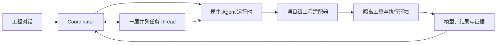

<p align="center">
  
</p>

<p align="center">
  <strong>以自然语言为入口的模型驱动系统工程工作空间。</strong><br>
  描述你想开发的系统，讨论设计，检查真实结果。
</p>

<p align="center">
  <a href="https://mingxiye.github.io/Manta/">产品网站与交互演示</a> ·
  <a href="#开始使用">开始使用</a> ·
  <a href="docs/demo.md">STF 演示指南</a> ·
  <a href="README.md">English</a>
</p>

---

Manta 希望把与编程 Agent 协作的方式带到系统工程中。你可以从一个工程目标、现有模型或失败测试开始，与 **Coordinator 和一层并列任务 thread** 交流，再从对话中打开模型、文档、仿真和证据。

产品的目标是让复杂工程可以通过语言来推进。专业工具、可追溯的决定和有效证据仍然是工程工作的基础。

> [!NOTE]
> Manta 当前是研究原型。部分工具链与工程增量已实际执行，完整 STF 任务开发和验收尚未完成。网站演示回放已保存的执行结果，不会启动实时 Agent 或求解器。产品网站现为公开静态展示，不是托管 Agent 服务。

## 先看看它如何工作

**[打开 STF 交互演示 →](https://mingxiye.github.io/Manta/#demo)**

网站改用 GitHub Pages；维护者启用 Pages 后此地址才会可用。[配置说明](docs/github-pages.md)。

演示选择了一次 STF 低电量处理的软件集成迭代。Coordinator 保留在主聊天，右侧打开平级 thread；你可以体验已标注的介入和转发示例，查看交付与复核，再从聊天中打开设计关系、固定测试配方、原始与修复配置的遥测及证据。

| 已记录的原生执行 | 实际观察结果 |
| --- | --- |
| 原始配置 | **3 / 5** 项观测判据通过，保留失败 |
| 修复配置 | **5 / 5** 项观测判据通过，**473** 个 EPS 遥测样本 |
| 可检查的证据 | 原始 CSV、模型和输入哈希、逐项观测结果 |

这些执行覆盖选定的 **NOS3 / cFS / NASA 42 / EPS 软件集成链**。它们不能证明完整 STF 任务、科学数据交付、硬件合格或飞行就绪。演示叙事经过整理；数值和判据结果来自 2026 年 10 月 23 日保存的原生执行。范围与复现说明见[演示指南](docs/demo.md)。

## 让对话承载工程工作

**看得到全局，也能介入细节。** Coordinator 维护目标、依赖、决定和待决问题，thread 承担具体任务。你可以直接与任意 thread 交流。Coordinator 在需要子任务结果时等待，收到后检查产物、记录复核，再向你汇总。

**工具随着任务出现。** 模型、代码、电路、几何和仿真结果都是可以打开检查的产物。中间调用与日志按需展开，重要结论和产物入口留在对话中；失败结果与修订后的结果一起保留。

**选择熟悉的 Agent，配置自己的模型。** Manta 复用 **Codex app-server** 和 **Claude Agent SDK** 的原生运行时。模型名、endpoint 和 API key 是连接配置；自定义提供方需实际测试，API 兼容不意味着所有 Agent 功能都兼容。

**接着已有项目继续。** 选择工程文件夹后，可以要求调查故障、修改需求、比较方案或准备评审。流程允许迭代返工，各部分不必处于相同阶段。V 模型表达设计与验证的对应关系，不是强制单向前进的向导。

## 专业工具接入

下面列出源码中的适配器与工作面。可用性取决于项目配置；安装 Node 应用不会自动配齐全部求解器。

| 接入 | Manta 中可做的工作 | 当前范围 |
| --- | --- | --- |
| **SysML v2 / KerML** | 源码编辑、语义检查、查询、结构图、大纲与诊断 | 固定 Open-MBEE 内核；不执行 SysML 动态行为 |
| **OpenModelica** | 模型与参数编辑、原生作业、曲线及 CSV 导出 | 需要配置执行环境 |
| **ngspice** | 原生电路瞬态分析与结果曲线 | 需要配置执行环境 |
| **OpenSCAD** | 几何生成、STL 旋转与缩放检查 | 需要配置执行环境 |
| **NOS3 / cFS / NASA 42** | 选定软件集成配方、遥测与检查 | 不代表任意完整任务均已验证 |
| **GDAL / PROJ / NASA 42 轨道** | 地理作业、坐标处理、原生轨道输出和地图预览 | 选定 Linux Docker 流程已验证，详见部署范围 |
| **外部 MCP** | 项目级 stdio 与 Streamable HTTP 连接 | 各专业工具仍需单独配置和验收 |
| **文档与证据** | Markdown、源码、CSV/JSON 表格与曲线、有界 GeoJSON 预览 | 已登记的作业证据只读 |

Capella、Cameo、MATLAB/Simulink、FEM、RF、PCB 和硬件平台尚不能视为已集成。发现工具名称或连通 MCP，不足以证明专业工程流程已跑通。

## 开始使用

### Linux Docker 部署

当前实际验证的平台是 **Linux amd64**，需要已有的 Docker Engine 和
**Docker Compose 2.20+**。Node、Git、Python、Codex CLI 和 Claude Agent SDK
都安装在镜像里，不需要在宿主机安装工程工具链。

```sh
git clone https://github.com/MingxiYe/Manta.git
cd Manta
sh install.sh                    # 全部支持的工具组，包含 NOS3
# 或：sh install.sh --preset=minimal
# 或：sh install.sh --tools=scipy,ngspice,modelica
```

打开 **[localhost:4317](http://127.0.0.1:4317)**，在「设置 → 模型与 API」中配置并测试连接。
新建项目时，文件夹留空即可自动创建托管工程目录，然后描述任务。
远程服务器使用 SSH 端口转发，具体命令见 [Docker 安装说明](docs/docker.md)。

另有可选的 [rootless broker 模式](docs/docker.md#opt-in-rootless-task-isolation)：命令和
原生 Codex/Claude、ngspice/OpenSCAD/OpenModelica、GIS 与轨道流程在独立任务容器中执行，
还可选装 NOS3，需要已有的 rootless Docker。浏览器/桌面和 stdio MCP 按项目隔离，
SciPy 数值服务已接入独立任务容器。stdio MCP 可按连接器配置允许访问的公网 HTTPS 域名，
通过受控代理联网，任务容器仍不直接联网；HTTP MCP 保留显式端点与凭证范围；STF 和旧 VM 管理入口仍暂缓。
具体支持范围及验收步骤见部署说明。

服务进程以非 root 用户运行。项目命令在应用的共享容器内执行，**不提供项目之间的系统级隔离**。
可选的 Linux 虚拟桌面和 NOS3/STF 飞行仿真使用固定配套容器，不接网络、不挂载 Docker socket，
也不要求宿主机改成 rootless Docker。项目和应用状态保存在 Docker 数据卷中。

完整镜像包含可选的 FreeCAD、Scilab；同时选择 Modelica 与桌面工具组时安装 OMEdit。
隔离浏览器支持站点 Cookie、表单和逐跳重定向，不导入宿主账号状态。
与原版的差异见[功能对照](docs/docker.md#feature-comparison-with-the-original-source)。

工具组选择、运行时 `.env` 配置、升级、备份和验收方式见 [Docker 安装说明](docs/docker.md)。
API 密钥在运行时传入，不写入镜像。Windows/macOS/ARM64 验证及原生桌面外壳暂缓；
当前不宣称完整 STF 任务已验收，也不保证任意模型网关都能稳定完成无人值守任务。

### 从源码运行应用

这是另一种安装方式，需要宿主机具备 **Node.js 22.13+** 和 npm：

```sh
npm ci
npm run doctor
npm start
```

与 Docker 镜像不同，`npm ci` 不安装 Codex CLI、浏览器或工程求解器，需要单独配置。
原有 macOS 桌面启动器和 Apple Silicon VM 流程保留各自的依赖要求；Docker 安装器不等于
复原历史 VM 冻结包。详见 [安装与平台范围](docs/installation.md)、
[仓库范围](REPOSITORY_SCOPE.md)和 [Agent 运行时](docs/agent-runtime.md)。

本地配置可从 `.env.example` 复制到 `.env`；不要提交密钥或运行数据。
界面输入的密钥仅保存在进程内存中，重启后需重新输入。Manual 和 Auto 均保留应用及原生运行时的审批规则。
服务仅监听本机回环地址，尚无多用户认证；产品静态网站通过 GitHub Pages 独立发布。

### 从一句工程需求开始

```text
开发一颗执行 STF 科学任务的小卫星：在美国本土、阿拉斯加和
夏威夷上空采集科学数据，只在美国附近采集；自主处理故障；
科学采集至少持续三个月；全部采集的科学数据在 24 小时内
送达地面；航天器健康优先于采集。

请自行核对权威公开资料，列出缺失的决定，开发工程模型，
执行可用的验证。保留未验证的要求，说明还需要哪些证据。
```

这段需求描述的是**从需求开始的目标案例**，不承诺完整任务已经开发或验收通过。现有候选设计文档是评测参考，不应偷偷预装为从零测试的输入。网站中的已记录演示是范围更小、单独验收的工程增量。

## Manta 如何组织工作



Manta 管理项目上下文、任务协调、权限桥、产物导航和证据交接；Codex 与 Claude 提供原生 Agent 运行时。专业执行使用配置好的工具和 runner。任务完成、求解成功、判据通过和系统被接受，各有各的依据。

## 正在推进的目标

**先完整 STF，再 Apollo。** Manta 的目标是支持任务需求、设计、实现、集成、验证、确认及后续变更等真实系统工程工作。

当前里程碑包括有限范围的模型校验、数值分析与选定软件集成。完整任务覆盖、数据交付、更全面的详细设计、硬件/HIL、环境与寿命试验，以及独立评审仍有未完成项。适用要求会保持开放，直到有效证据或有权者的决定将其闭合。

长期体验是“说出想开发的复杂系统，再通过对话把它做出来”。Manta 尚未完成 Model 3、Apollo 飞船或完整验收通过的 STF 任务。

## 开发与深入阅读

先运行不使用模型密钥的应用冒烟检查 `npm run smoke`，再运行应用测试 `npm test`。`server/` 是协调与工程服务，`public/` 是对话和产物工作面，`runners/` 与 `vm/` 保存隔离执行源码，`website/` 保存产品网站与交互演示。

[安装与平台范围](docs/installation.md) · [路线](docs/ROADMAP.md) · [第一项任务](docs/first-task.md) · [工作流](docs/mbse-workflow.md) · [架构](docs/architecture.md) · [SysML 后端](docs/model-backend.md) · [外部 MCP](docs/external-mcp.md) · [工程记录](docs/engineering-state.md)

仓库不包含密钥、运行聊天、虚拟机磁盘、下载的第三方工程及完整工程证据工作区。网站仅收录经整理的已记录示例，详见 [REPOSITORY_SCOPE.md](REPOSITORY_SCOPE.md)。

**许可证：** Manta 自有代码与原创文档采用 [Apache 2.0](LICENSE)，版权署名为 Copyright 2026 MingxiYe。详见 [NOTICE](NOTICE) 和[第三方声明](THIRD_PARTY_NOTICES.md)；随附组件与上游衍生内容保留各自许可。

公开前检查、实际测试范围与未完成的发布条件见[公开源码审查](docs/public-readiness.md)。
