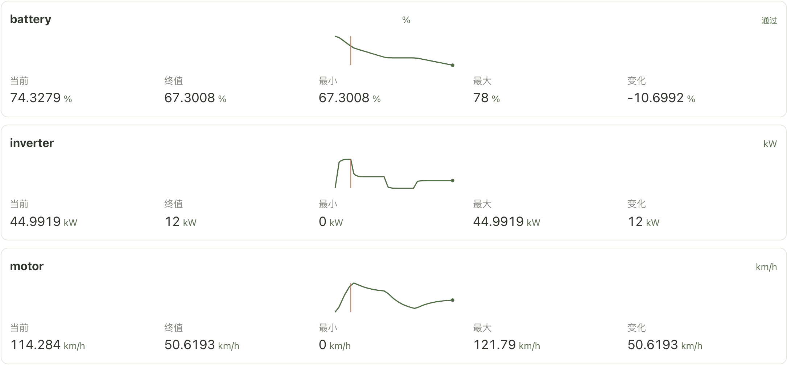
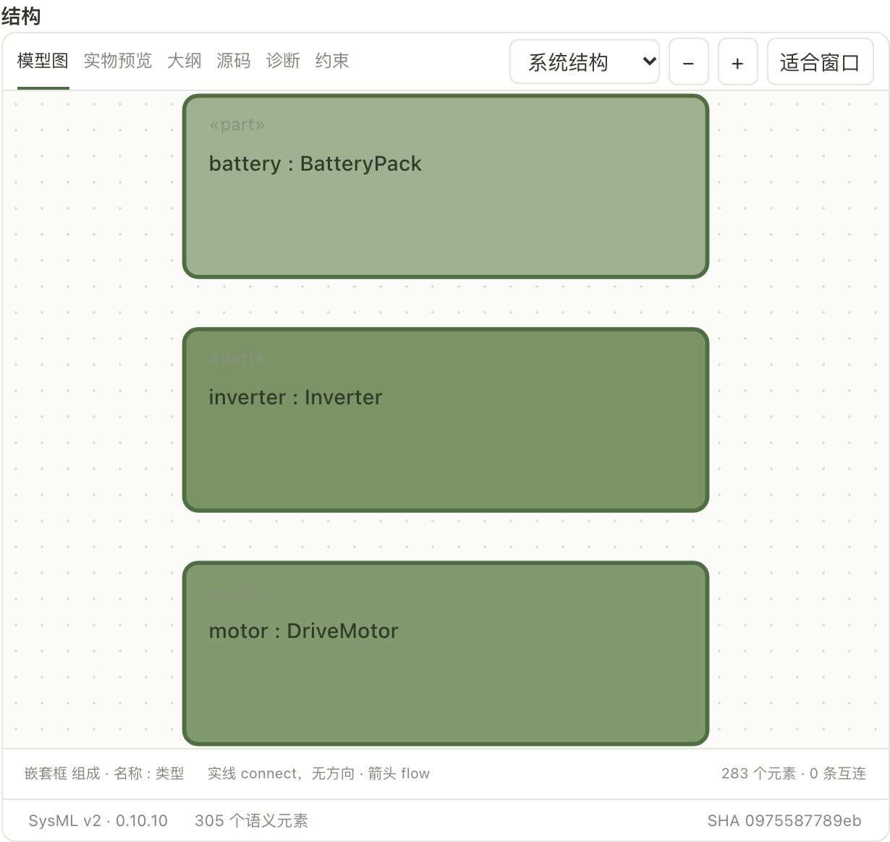
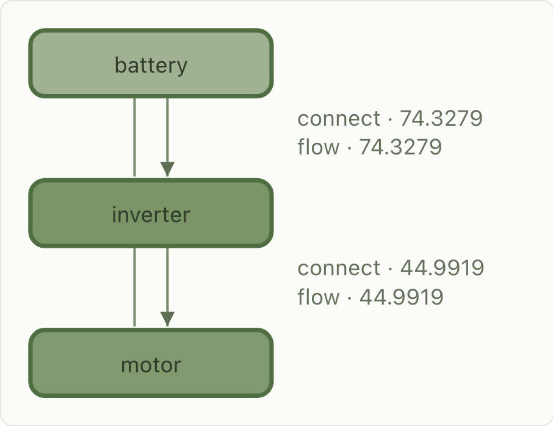
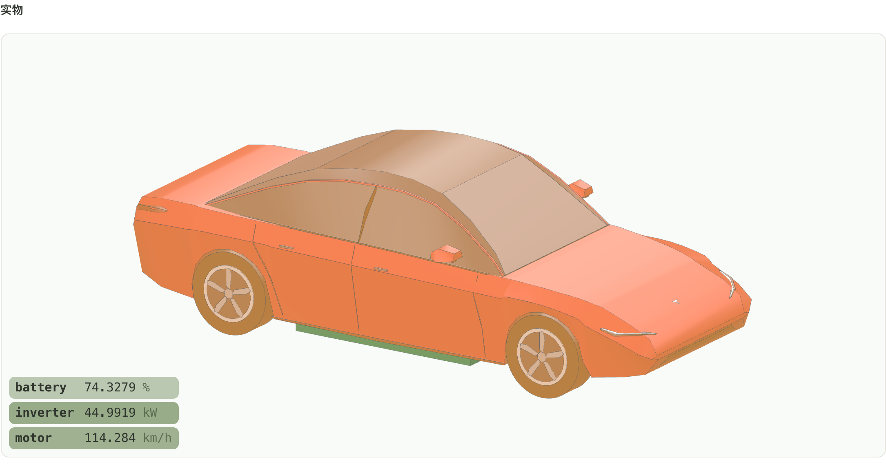
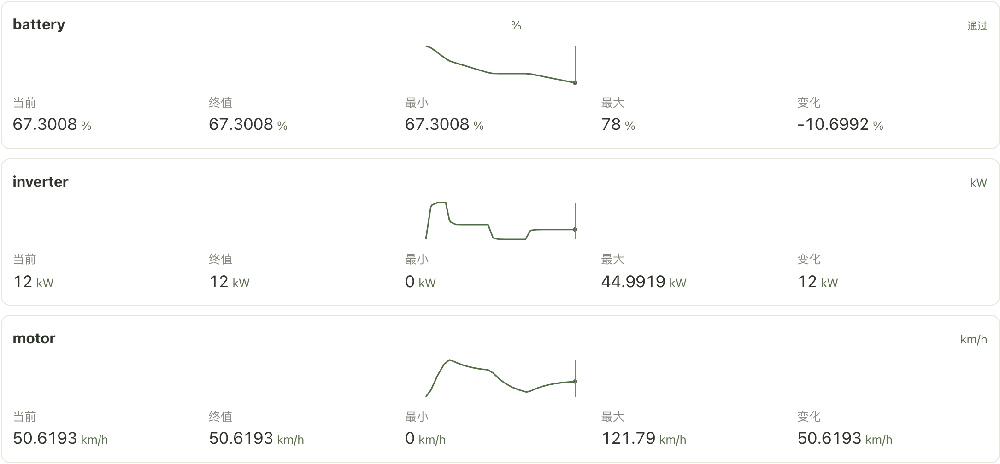
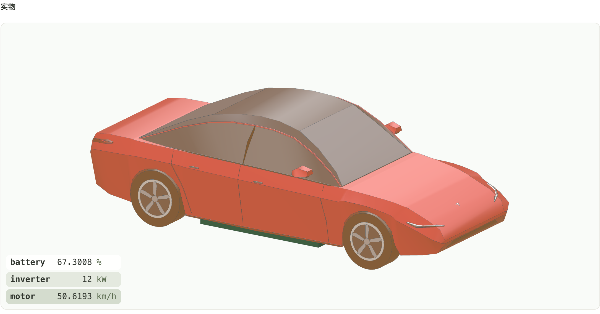

# 新能源汽车起步仿真

这份说明对应正在运行的工作台：打开 [http://127.0.0.1:4317/?project=project_5b8ed67c-b081-4fc9-b2a4-277bfe34ca1b](http://127.0.0.1:4317/?project=project_5b8ed67c-b081-4fc9-b2a4-277bfe34ca1b)，进入项目「新能源汽车」，在专业模型里打开 `electric-vehicle.sysml`，再点 **查看示例轨迹**。播放条拖动的是同一条 60 秒记录，指标卡、结构图、流向图和三维整车使用同一个采样时刻。

截图取自这条轨迹的两个时刻：加速段末端 **8.0 s**，以及仿真结束 **60.0 s**。工作台里三张指标卡并排，结构图与流向图也并排；下面按块分开截取，让数值、单位和图形都能看全。

## 这条轨迹在算什么

`VehicleDrive.mo` 描述一次 60 秒起步。三个输出与界面单位一致：

| 信号 | 含义 | 单位 | 初值 |
| --- | --- | --- | --- |
| `battery` | 荷电状态 | % | 78 |
| `inverter` | 逆变器输出功率 | kW | 0 |
| `motor` | 车速 | km/h | 0 |

功率指令 `command` 按时间分段，单位也是 kW：前 8 秒要 45，接着到 25 秒降到 18，25 到 40 秒松为 0，最后 20 秒维持 12。逆变器以 1.2 秒的时间常数跟上这条指令。车速被功率推高，同时受到与自身成正比的阻力。荷电状态按逆变器功率下降。

```modelica
command = if time < 8 then 45 else if time < 25 then 18 else if time < 40 then 0 else 12;
der(inverter) = (command - inverter) / 1.2;
der(motor) = (1.6 * inverter - 0.35 * motor) / 3;
der(battery) = -0.012 * inverter;
```

实验从 0 到 60 秒，步长 0.5 秒，共 121 行。因为逆变器跟不上指令的阶跃，功率峰值出现在 8.0 秒，车速峰值滞后到 9.5 秒。

| 时刻 | 指令 | battery | inverter | motor |
| --- | --- | --- | --- | --- |
| 0 s | 45 kW | 78 % | 0 kW | 0 km/h |
| 8.0 s | 切到 18 kW | 74.3279 % | 44.9919 kW | 114.284 km/h |
| 9.5 s | 18 kW | 73.6924 % | 23.3578 kW | 121.79 km/h（全程最大） |
| 25 s | 切到 0 | 70.2672 % | 18 kW | 89.0343 km/h |
| 40 s | 切到 12 kW | 70.0080 % | 0 kW | 16.8788 km/h |
| 60 s | 12 kW | 67.3008 % | 12 kW | 50.6193 km/h |

## 和整车模型如何对应

`electric-vehicle.sysml` 里的轿车外形是示意尺寸：车长 4,720 mm，轴距 2,875 mm，轮距 1,584 mm，轮胎按 235/45R18 取半径 334.35 mm。底盘内三件与 FMU 输出同名：

- `battery` 在地板下，中心大约在 X = −200 mm、Z = 70 mm
- `inverter` 在前舱中部，X = 500 mm、Z = 175 mm
- `motor` 更靠前，X = 1,200 mm、Z = 250 mm

连接是 `battery.output → inverter.input → motor.input`。`flow power` 走第一段，`flow torque` 走第二段。`PullAway` 调用同目录的 `electric-vehicle.fmu`，停止时间 60 秒、步长 0.5 秒，返回值是 `motor`。`PullAwayCheck` 要求这个返回值大于 49 且小于 52。记录结束时的车速是 50.6193 km/h，落在这个区间内。

界面上的「示例数据」表示这是随模型保存的 FMPy 协同仿真结果，步长 0.5 秒、121 行，本次打开没有重新求解。记录清单把 `battery` 标为通过，所以荷电状态卡片右上角显示「通过」。车速判据写在 SysML 的 `PullAwayCheck` 里，对照的是上表最后一行。

## 播放如何带动各个视图

拖动时间或点播放时，四个表面读的是同一行采样：

- 指标卡的「当前」和迷你曲线上的竖线跟着采样移动。终值、最小、最大、变化量始终是整段轨迹的统计。时间读数固定一位小数并占住宽度，「时间」和单位 `s` 不会随数字长短左右跳。
- 结构图把同名零件 `battery`、`inverter`、`motor` 按该信号在最小到最大之间的位置着色，越接近本段峰值越深。
- 流向图沿电池、逆变器、电机往下画 `connect` 和 `flow`。电池到逆变器的标注取荷电状态的当前值，逆变器到电机的标注取功率的当前值。线的粗细随该数值相对峰值的比例变化。
- 三维视图里这三件零件按同样的比例换成绿色发光。车身其余部分的亮度跟着车速：速度越高，车身越亮。左下角读数同时给出名称、当前值和单位。

## 8.0 秒：加速段末端

此时指令已经切到 18 kW，逆变器仍停在 44.9919 kW，车速 114.284 km/h，荷电状态降到 74.3279 %。迷你曲线上的竖线停在功率平台的末端、车速爬升的后段。





结构图只框出三个同名零件。电池颜色浅一些，因为它才从 78 % 降到 74 %，离本段最小值 67.3 % 还远；逆变器和电机都接近各自峰值，所以绿色更深。





地板下的绿色块是电池包。逆变器和电机在车身内部，由发光和左下角读数表示。车身整体偏亮，对应这一刻 114 km/h 的车速。



## 60.0 秒：仿真结束

功率已经跟上 12 kW 的巡航指令，车速回到 50.6193 km/h，荷电状态 67.3008 %。竖线停在每条曲线的末端，当前值与终值相同。车身亮度回落，左下角读数换成结束时刻的三个数。





## 这些图说明到哪一步

图中的曲线、着色和读数都来自 `electric-vehicle-drive.csv`，也就是 `electric-vehicle.fmu` 的这次协同仿真。外形、轮毂和车身断面是示意几何，动力学是上面三行微分方程，用来把功率指令、功率、车速和荷电状态连到同一辆车上看。它不代替实车试验，也不表示整车已经验收。
