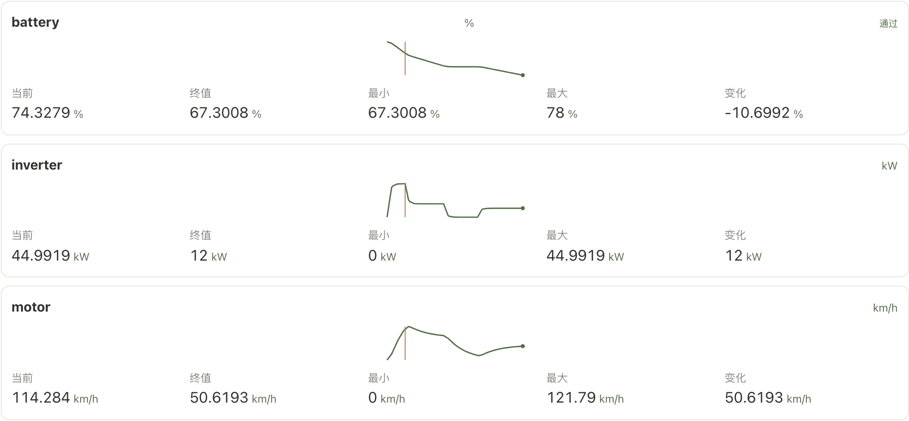
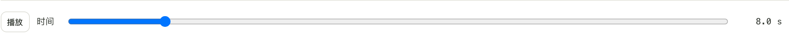
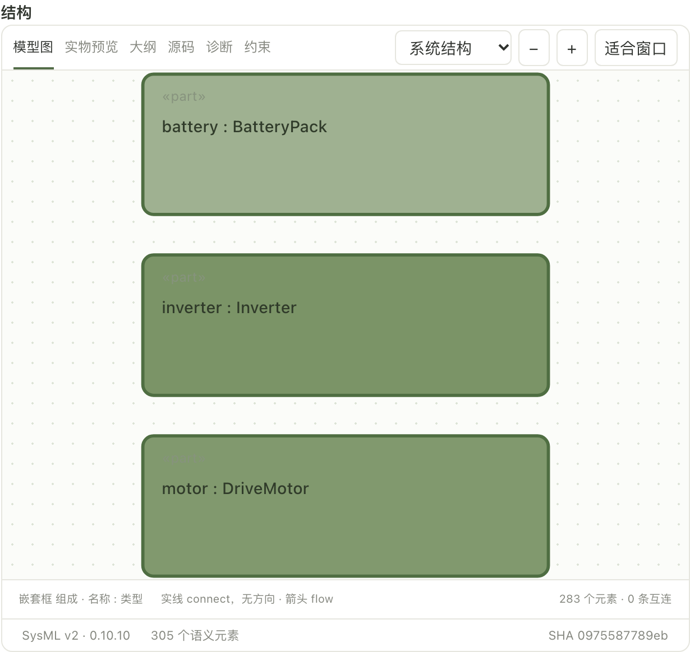
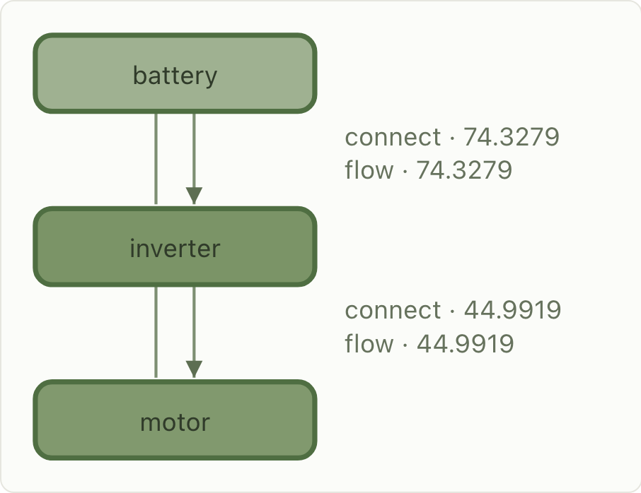
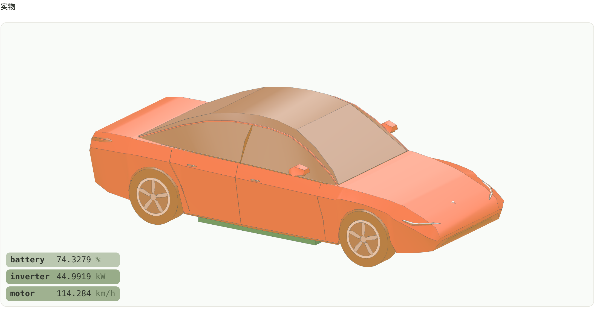
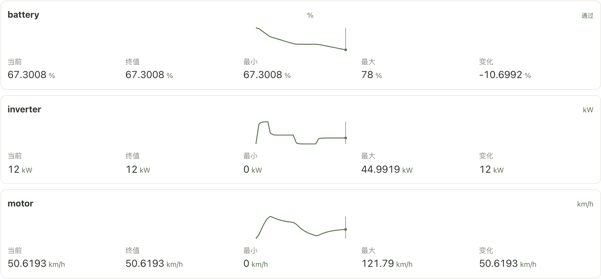
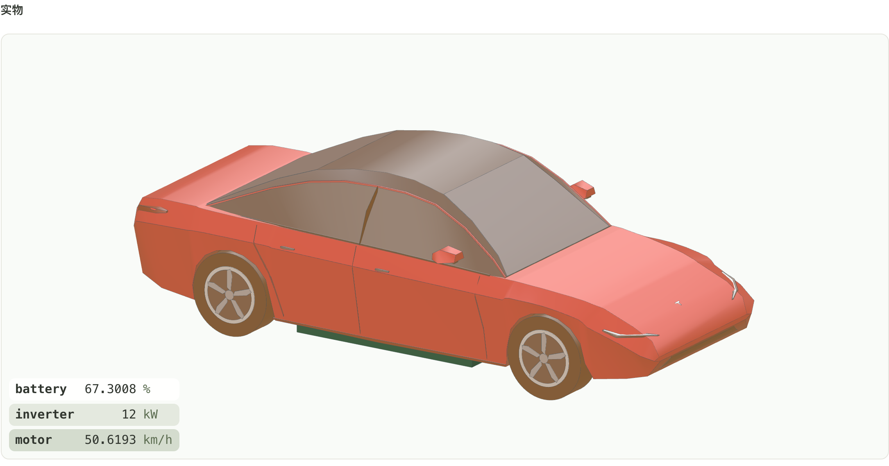

# 电动轿车起步仿真

示例文件在 [examples/electric-sedan](../examples/electric-sedan)。在项目 Library 打开 `Sedan.sysml`，用同目录的 `Sedan.recorded.json` 和 `trajectory.csv` 回放。播放条拖动的是同一条 60 秒记录，指标卡、结构图、流向图和三维整车使用同一个采样时刻。外形打开 `Sedan.appearance.sysml` 的 **实物预览**。

下面按这条记录看两个时刻：加速指令切到 60 kW 的 **8.0 s**，以及仿真结束 **60.0 s**。

## 这条轨迹在算什么

`Sedan.mo` 描述一次 60 秒起步。三个输出与界面单位一致：

| 信号 | 含义 | 单位 | 初值 |
| --- | --- | --- | --- |
| `battery` | 荷电状态 | % | 80 |
| `inverter` | 逆变器交流功率 | kW | 5.76 |
| `motor` | 车速 | km/h | 0 |

直流功率指令 `command` 的单位是 W。前 8 秒从 6 kW 线性升到 60 kW，8 到 20 秒保持 60 kW，20 到 32 秒降到 18 kW，之后维持 12 kW。逆变器功率是指令乘以效率 0.96，没有一阶滞后。驱动力有 4800 N 上限，阻力包含滚阻和风阻。荷电状态按直流指令和 60 kWh 电池容量下降。车速由 `motor = 3.6 * speed` 换成 km/h。

```modelica
command = if time < 8 then 6000 + 6750*time else if time < 20 then 60000 else if time < 32 then 18000 else 12000;
inverter = etaInv*command/1000;
motor = 3.6*speed;
der(battery) = -100*command/capacity;
```

实验从 0 到 60 秒，步长 0.1 秒，共 601 行。

| 时刻 | 直流指令 | battery | inverter | motor |
| --- | --- | --- | --- | --- |
| 0 s | 6 kW | 80 % | 5.76 kW | 0 km/h |
| 8.0 s | 切到 60 kW | 79.8790 % | 57.6 kW | 55.5542 km/h |
| 60 s | 12 kW | 79.2901 % | 11.52 kW | 96.7485 km/h |

## 和整车模型如何对应

`Sedan.appearance.sysml` 里已绘制实体的外包尺寸是 4,730 × 2,140 × 1,487.5 mm。四条轮胎半径 330 mm、宽 220 mm，中心在 X = ±1,400 mm、Y = ±825 mm、Z = 330 mm。与 FMU 输出同名的三件：

- `battery` 中心在 X = 0 mm、Z = 350 mm，尺寸 2,200 × 1,200 × 140 mm
- `inverter` 中心在 X = 1,550 mm、Z = 780 mm，尺寸 450 × 520 × 150 mm
- `motor` 是沿 Y 轴的圆柱，中心在 X = 1,470 mm、Z = 510 mm，半径 170 mm、高 600 mm

`Sedan.sysml` 里 `flow of Power` 从 `battery.electricalPower` 到 `inverter.electricalPower`，`flow of Torque` 从 `inverter.shaftTorque` 到 `motor.shaftTorque`。`LaunchFMU` 调用同目录的 `Sedan.fmu`，停止时间 60 秒、步长 0.1 秒。`SedanSystem::launch` 的 `rangeCheck` 要求结束时 `battery` 在 79 到 80、`inverter` 在 11 到 12、`motor` 在 50 到 100。`verdicts.json` 里这条判据 `holds` 为 true，结束值是 79.2901 %、11.52 kW、96.7485 km/h。

回放读的是已保存的 601 行 FMPy 轨迹，打开示例时不再求解。

## 播放如何带动各个视图

拖动时间或点播放时，四个表面读的是同一行采样：

- 指标卡的「当前」和迷你曲线上的竖线跟着采样移动。终值、最小、最大、变化量始终是整段轨迹的统计。时间读数固定一位小数并占住宽度，「时间」和单位 `s` 不会随数字长短左右跳。
- 结构图把同名零件 `battery`、`inverter`、`motor` 按该信号在最小到最大之间的位置着色，越接近本段峰值越深。
- 流向图沿电池、逆变器、电机往下画 `connect` 和 `flow`。电池到逆变器的标注取荷电状态的当前值，逆变器到电机的标注取功率的当前值。线的粗细随该数值相对峰值的比例变化。
- 三维视图里这三件零件按同样的比例换成绿色发光。车身其余部分的亮度跟着车速：速度越高，车身越亮。左下角读数同时给出名称、当前值和单位。

## 8.0 秒：指令切到 60 kW

直流指令切到 60 kW，逆变器功率是 57.6 kW，车速 55.5542 km/h，荷电状态 79.8790 %。迷你曲线上的竖线停在这一采样。






结构图框出三个同名零件，颜色按该信号在本段最小到最大之间的位置变化。





电池、逆变器和电机按当前比例换成绿色发光，车身其余部分的亮度跟着车速。左下角读出名称、当前值和单位。



## 60.0 秒：仿真结束

直流指令是 12 kW，逆变器 11.52 kW，车速 96.7485 km/h，荷电状态 79.2901 %。竖线停在每条曲线的末端，当前值与终值相同。这三个终值都落在 `rangeCheck` 里。





## 这些图说明到哪一步

曲线、着色和读数来自 `examples/electric-sedan/trajectory.csv`，也就是 `Sedan.fmu` 的这次协同仿真。外形是 `Sedan.appearance.sysml` 和 `Sedan.scad` 里的同一组实体，动力学是 `Sedan.mo` 的方程。它把功率指令、逆变器功率、车速和荷电状态连到同一辆车上看。这是概念设计记录，不代替实车试验。
